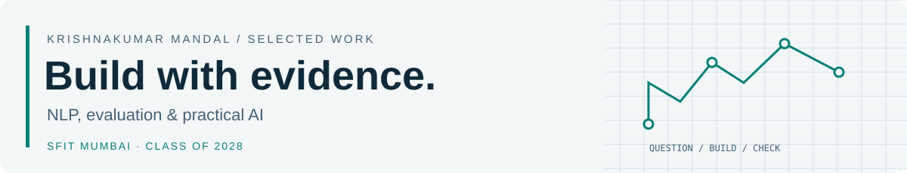
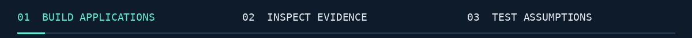
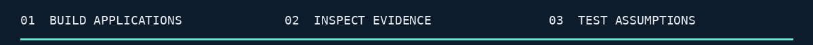

<picture>
  <source media="(prefers-color-scheme: dark)" srcset="assets/banner-dark.svg">
  
</picture>

<picture>
  <source media="(prefers-reduced-motion: reduce)" srcset="assets/intro-static.png">
  
</picture>

# Krishnakumar Mandal

Third-year **AIML student at St. Francis Institute of Technology, Mumbai** · graduating **May 2028**.
I work on small language models, claim-verification tools and interactive AI applications, with an interest in how people assess and use their outputs.

**Seeking paid, remote internships** in AI/ML engineering, Python/application development or research assistance.
[Connect on LinkedIn](https://www.linkedin.com/in/krishnakumar-mandal-03722933b/) · [Explore my repositories](https://github.com/krishmannadal?tab=repositories)

## Selected work

### 01 / [Mini-R1](https://github.com/krishmannadal/mini-r1) — small-model experiments
42.1M-parameter PyTorch Transformer with pretraining, verified arithmetic supervision and replay experiments. The reported results show narrow arithmetic retention and weak word-problem performance; the README explains the controls and confounds.

**Python · PyTorch · SentencePiece**  
[Code & setup](https://github.com/krishmannadal/mini-r1#readme) · [Recorded benchmarks](https://github.com/krishmannadal/mini-r1/blob/main/reports/task24_final_benchmarks.md) · [Released checkpoints](https://github.com/krishmannadal/mini-r1/releases/tag/v1.0.0)

### 02 / [StemLab](https://github.com/krishmannadal/StemLab) — music rehearsal studio
Browser application integrating pretrained Demucs separation, a synchronized mixer, local effects and WAV exports. The public site is reachable; studio features require an account and suitable desktop hardware.

**JavaScript · ONNX Runtime Web · Web Audio · Netlify**  
[Open deployed site](https://stemlab-krishmannadal.netlify.app/) · [Code & feature status](https://github.com/krishmannadal/StemLab#readme)

### 03 / [Nullius](https://github.com/krishmannadal/Nullius) — inspect claim verification
An inspection harness that exposes retrieval, pairwise verification and aggregation separately. Includes traces, null baselines, a local API and an annotation workflow. Human evaluation is pending; debug-corpus scores are not detection benchmarks.

**Python · FastAPI · Streamlit · BM25 · FAISS · Transformers**  
[Local walkthrough](https://github.com/krishmannadal/Nullius#try-it-locally) · [Research readiness](https://github.com/krishmannadal/Nullius/blob/master/docs/S1_READINESS.md)

### 04 / [WeCode](https://github.com/AmanGound2237/Wecode) — collaborative AI practice platform
Team project maintained by Aman Gound. My recorded contributions include the Wandbox runner migration, editor/math presentation, deployment preparation, paper workspace and tutor widget. The runner executes Python; it does not judge solution correctness.

**TypeScript · Next.js · Prisma · PostgreSQL · Monaco**  
[Browse live problems](https://wecode-two.vercel.app/problems) · [Sign in](https://wecode-two.vercel.app/sign-in) · [My commits](https://github.com/AmanGound2237/Wecode/commits/main/?author=krishmannadal)

More applied work

- **[Traffic RL Twin](https://github.com/krishmannadal/traffic-rl-twin)** — local SUMO simulation, FastAPI/WebSocket dashboard and DQN/PPO training paths. Benchmark reproduction remains pending.
- **[Disk morphology exploration](https://github.com/krishmannadal/UNSUPERVISED_ASTRONOMY)** — FITS preprocessing, convolutional autoencoder, UMAP and HDBSCAN. Exploratory work for EXXA test tasks; no scientific discovery or program selection is claimed.

## Tools I use

| Purpose | Tools | Evidence |
| --- | --- | --- |
| Model experiments | Python, PyTorch, SentencePiece, NumPy | Mini-R1, disk morphology |
| Retrieval & evaluation | BM25, FAISS, Transformers, pytest | Nullius |
| APIs & applications | FastAPI, JavaScript, TypeScript, Next.js, React | Nullius, StemLab, WeCode |
| Data & delivery | Prisma/PostgreSQL, Netlify Functions/Blobs, Git | WeCode, StemLab |

## Questions I want to study

How should language models be evaluated when fluent answers can be wrong? What helps people recognize unreliable output? How do data choices change what small models retain?

**Research interests:** NLP · language-model evaluation · AI reliability · human–AI interaction.

## Contribution activity

<picture>
  <source media="(prefers-color-scheme: dark) and (prefers-reduced-motion: reduce)" srcset="assets/contributions/snake-dark-static.svg">
  <source media="(prefers-reduced-motion: reduce)" srcset="assets/contributions/snake-static.svg">
  <source media="(prefers-color-scheme: dark)" srcset="assets/contributions/snake-dark.svg">
  
</picture>

[View the full, uneaten calendar](assets/contributions/snake-static.svg)

How this stays up to date

This is my real rolling 12-month GitHub contribution calendar, animated by [Platane/snk](https://github.com/Platane/snk). The snake eats cells during playback; the static view preserves the complete grid. The workflow checks GitHub hourly for contributions across repositories and after profile-repository changes. GitHub indexing, workflow scheduling and image caching can delay visible updates.

[Source day counts](assets/contributions/calendar.json) · [Refresh workflow](https://github.com/krishmannadal/krishmannadal/actions/workflows/contribution-snake.yml)

GitHub achievement

**YOLO** · awarded by GitHub on 23 October 2026 for merging a pull request without a review. [View the achievement](https://github.com/krishmannadal?achievement=yolo&tab=achievements).

Static introduction and motion notes

[Static version](assets/intro-static.png). The animation plays once, then settles; all essential information is available as text above.

[LinkedIn](https://www.linkedin.com/in/krishnakumar-mandal-03722933b/) · [GitHub](https://github.com/krishmannadal)
