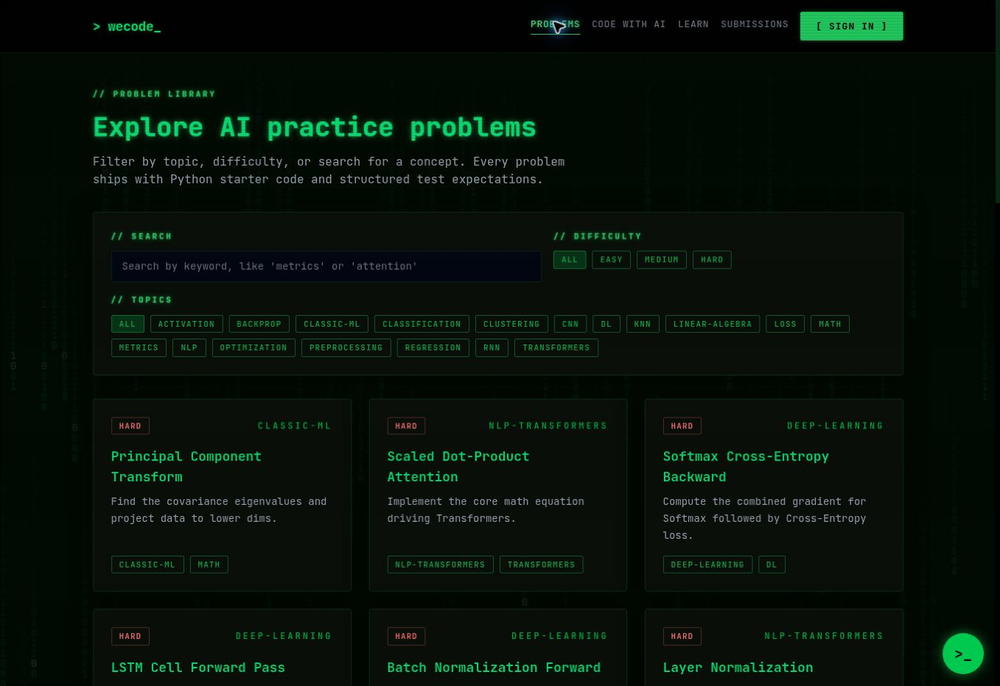
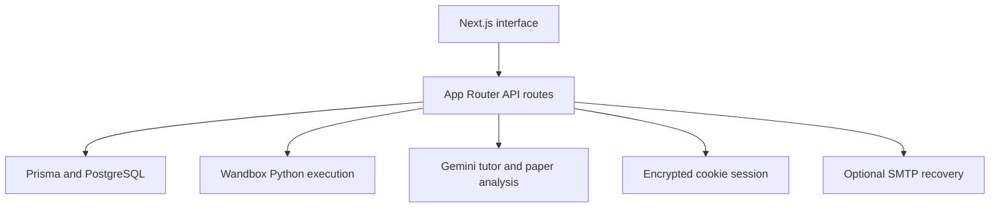

# WeCode
### AI/ML practice, a Python workspace and paper-assisted learning

WeCode is a **collaborative application maintained by Aman Gound**, with contributions from Krishnakumar Mandal. Learners can browse AI/ML problems, edit Python in Monaco, execute snippets and explore AI-assisted learning/paper workflows.

[Browse live problems](https://wecode-two.vercel.app/problems) · [Sign in](https://wecode-two.vercel.app/sign-in) · [Contribution history](https://github.com/AmanGound2237/Wecode/commits/main/)

**TypeScript · Next.js 16 / React 19 · Prisma / PostgreSQL · Monaco · Gemini · Wandbox**

> **Execution is not correctness judging.** The current runner sends Python to Wandbox and records `ACCEPTED` when the process reports success. It does not compare outputs against problem test cases or establish that an answer is correct.


*Public catalog captured on 23 October 2026; no authenticated runner result is implied.*

## Implemented application paths

- Problem library, topic/difficulty filtering, problem details and Python starter code.
- Monaco editor with a custom theme and mathematical/LaTeX rendering.
- Wandbox-backed Python execution and submission records for signed-in users.
- Email/password account routes, profiles and admin problem-management paths.
- PDF/paper breakdown and code workspace; floating Gemini tutor widget.

The public problem catalog and sign-in page were observed live on 23 October 2026. Runner execution, authenticated submissions, email recovery and paid/quota-limited AI calls were not verified end to end in that audit. The supplied `/sing-in` URL returned 404; `/sign-in` is the route implemented by the app.

## Architecture



Problem test expectations exist as content, but the execution route does not implement a hidden-test correctness judge. Snippets sent to Run leave the application server for Wandbox; text/paper AI requests use Gemini.

## Local setup

Use Node.js **20.9+**, npm and PostgreSQL. Run from the repository root:

```bash
git clone https://github.com/AmanGound2237/Wecode.git
cd Wecode
npm ci
cp .env.example .env
# Windows PowerShell: Copy-Item .env.example .env
```

Edit `.env` to match the **variable names actually read by source**:

| Variable | Purpose |
| --- | --- |
| `DATABASE_URL` | PostgreSQL connection for Prisma |
| `SESSION_PASSWORD` | iron-session secret, at least 32 characters |
| `ADMIN_EMAILS` | Optional comma-separated admin email allowlist |
| `APP_URL` | Origin used in password-reset links; default localhost:3000 |
| `GEMINI_API_KEY` | Paper breakdown / shared Gemini helper |
| `GEMINI_API_KEY2` | Separate key read by floating chat route; currently required at module load/build |
| `SMTP_HOST`, `SMTP_PORT`, `SMTP_USER`, `SMTP_PASS`, `EMAIL_FROM` | Optional SMTP recovery delivery |

**The example file's `SESSION_SECRET` is stale:** `src/lib/session.ts` reads `SESSION_PASSWORD`. Set the latter. Do not copy `NODE_ENV=production` into normal local HTTP development; production cookies use Secure. Never commit real keys or database credentials.

```bash
npx prisma migrate dev
npm run db:seed
npm run dev
```

Use a disposable local database for initial migration/seeding. **Read `prisma/seed.ts` before running it:** it includes a hard-coded admin upsert/password. Do not run that unchanged against production or expose the seeded account publicly. No behavior change is made by this documentation proposal.

Open `http://localhost:3000`. For deployment: configure the server variables, apply reviewed migrations to the target database, run `npm run build`, then `npm start` or deploy via Vercel. `RUNNER_MODE`/Docker Python settings from older documentation are not consumed by the current Wandbox runner.

<details>
<summary>Usage and current external-service limits</summary>

Choose a problem, edit its starter Python, and press Run. Output reflects execution, not task correctness; an empty successful program may still receive the database label `ACCEPTED`. No extra package dependencies are installed in Wandbox by this code. External compiler availability, limits and network access can change.

Paper breakdown needs `GEMINI_API_KEY`; floating chat needs `GEMINI_API_KEY2`. The chat module throws at import if `GEMINI_API_KEY2` is missing, so this key is currently needed even for a full build. Both depend on provider model access/quota. The chat source uses a fixed model identifier. These paths need a real configured-provider check before being described as working production AI.

The current runner's catch-path message still refers to Docker even though execution has moved to Wandbox. That message is stale. The runner also reports provider-level limits without an application-level timeout classification. The README does not claim these issues are fixed.

</details>

## Contribution credit

The initial platform and migration foundation are recorded under **Aman Gound**. Krishnakumar Mandal's commits record:

- [`39d9813`](https://github.com/AmanGound2237/Wecode/commit/39d9813) — Wandbox runner migration and problem seed expansion.
- [`e035a47`](https://github.com/AmanGound2237/Wecode/commit/e035a47) — editor theme and LaTeX/math rendering.
- [`6c83e34`](https://github.com/AmanGound2237/Wecode/commit/6c83e34) and [`642eccb`](https://github.com/AmanGound2237/Wecode/commit/642eccb) — deployment preparation, UI/paper-workspace changes.
- [`feaba8d`](https://github.com/AmanGound2237/Wecode/commit/feaba8d), [`e1f5db7`](https://github.com/AmanGound2237/Wecode/commit/e1f5db7) — floating tutor integration and model identifier update.

This is change-history attribution, not a claim that one person independently implemented the whole project or trained Gemini.

## Status and next work

Application prototype; source and public-page audit only. No correctness-judging benchmark, learning-outcome study or user metrics are claimed. Next: implement real test-case judging, remove production seed credentials, align environment examples, qualify AI routes and add a repeatable authenticated smoke test. Build/migrations were not run against a database during this README audit.

No repository-level license file is present. Dependency licenses remain separate; this proposal adds no license.
